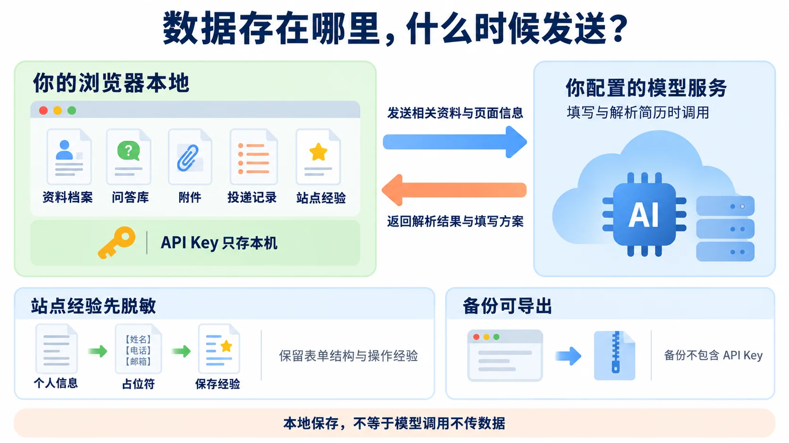
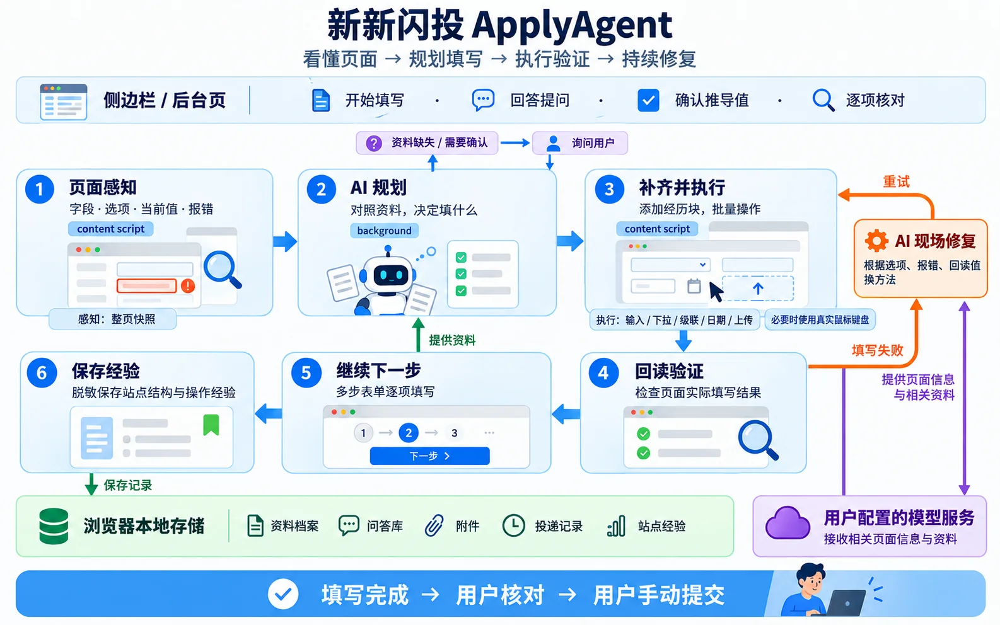

<div align="center">


# 新新闪投 ApplyAgent

**会看、会改、会问的网申填表 AI。**<br/>
打开任意招聘网站的申请页，点一下，用你的简历把整张表填好。

<p>
  <a href="LICENSE"></a>
  
  
  <a href="https://github.com/c-Xcan/ApplyAgent/releases"></a>
</p>

[快速开始](#快速开始) · [功能](#功能) · [数据与隐私](#数据与隐私) · [工作原理](#工作原理)

</div>

## 为什么做这个

秋招春招一投就是几十家，每家网申都要把姓名、学校、实习、项目重新填一遍。浏览器自带的自动填充只认得姓名电话，碰到自定义下拉、级联地区、日期面板、"添加一段经历"这类控件就没用了；按站点写适配脚本，网站一改版又失效。

新新闪投换了个思路：**不写任何站点规则，让 AI 像人一样看页面、填表单**。它读出页面上的每个字段和选项，对照你的资料规划好怎么填，逐个执行后再回读检查；填不上就看现场换方法，遇到资料里没有的问题就问你。

- **不挑网站**：不管是哪家招聘系统、什么样的组件库，都按同一套方式处理，不依赖站点适配。
- **不替你提交**：只负责填写，永远不会自动点最终「提交」，你检查完再自己点。
- **资料与记录保存在本机**：没有自建服务器，资料和记录存在你的浏览器里；填写时会调用你配置的模型服务。

## 功能

### 🧠 读懂任意表单

原生输入框、单选多选、自定义下拉（含搜索、多选、虚拟滚动）、省市区级联、日期和日期区间、文件上传都能识别和操作，iframe 和 Shadow DOM 里的表单也能处理。页面要先"添加一段教育经历"才出现的输入框，它会先点添加再填；多步表单填完一页会自动点「下一步」继续。


资料里没有的问题（比如"是否接受调剂""期望到岗时间"），会在侧边栏问你；AI 根据资料推导出来的答案，会先请你确认。回答自动存进问答库，以后任何网站遇到同样的问题都直接使用。你在网页上手动改过的值，它也会学下来。

### 📄 简历一键导入，多份档案

上传 PDF 或 DOCX 简历，AI 自动整理成结构化资料，检查后保存。可以建多个档案（比如技术岗和产品岗各一份），每个档案有独立的资料、问答库和附件。侧边栏里能随时查看简历原文和每一项资料，一键复制。

### ✅ 填完逐项核对

侧边栏列出每个字段的填写结果：已填、AI 撰写、失败、跳过。点一行会在页面上高亮对应的输入框；没填上的字段可以一键复制应填的值，手动粘贴进去。

### 📈 越用越快

每次填写后，按网站记下表单结构上的经验：哪个字段对应哪项资料、下拉里有哪些选项、哪种操作方式有效。同一个网站第二次填写时直接复用，规划更快、更省 token。每次填写还会自动记一条投递记录，没填上的字段也记在里面，方便回去补。

## 快速开始

### 方式一：下载安装包

1. 到 [Releases](https://github.com/c-Xcan/ApplyAgent/releases) 下载最新的 zip 并解压。
2. Chrome 或 Edge 打开 `chrome://extensions`，右上角打开「开发者模式」。
3. 点「加载已解压的扩展程序」，选择解压出的文件夹。

### 方式二：从源码构建

需要 **Node.js ≥ 20**。

```bash
git clone https://github.com/c-Xcan/ApplyAgent.git
cd ApplyAgent
npm install
npm run build
```

构建产物在 `dist/`，按方式一的第 2、3 步加载这个文件夹即可。

> 国内网络 `npm install` 慢的话，先执行 `npm config set registry https://registry.npmmirror.com`。

### 开始使用

1. 点工具栏上的扩展图标打开侧边栏，点「设置」打开后台页面。
2. 到 **设置 → 模型** 选接口类型，填接口地址、API Key、模型名，点「测试连接」，再点「保存设置」。
3. 到 **资料档案** 上传简历，检查 AI 整理出的资料后保存。
4. 打开网申页面，在侧边栏选好档案，点「开始填写当前页面」。
5. 填完在侧边栏逐项检查，确认无误后**自己点提交**。

首次安装会附带一份虚构人物的示例档案，可以照着它填自己的资料，不需要时删掉即可。

### 模型选择

支持两种主流的接口协议，市面上常见的大模型服务基本都能接入，在设置页的「接口类型」里选对应的一项即可。

模型需要支持工具调用（function calling）。下拉选项匹配这类小任务可以单独指定一个更快、更便宜的模型，在 设置 → 模型 里取消勾选「选项匹配等小任务也用这个模型」即可。

> 💡 **省钱建议**：不少大模型平台给新注册用户送免费额度。

## 数据与隐私



## 工作原理



</details>

## 开发

```bash
npm run build        # 产出 dist/
npm run dev          # 监听构建，改完代码在扩展页点刷新
npm run typecheck    # 类型检查
```

## 许可协议

[MIT](LICENSE)
